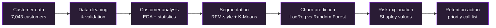
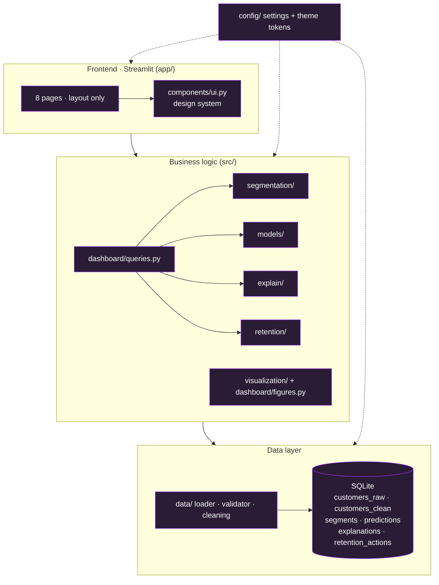

# Customer360 AI

**Intelligent customer analytics, segmentation and churn prediction platform**

[](https://github.com/Kalai-coder-DS/Customer-360/actions/workflows/tests.yml)


> **Live demo:** _add your Streamlit Community Cloud link here_ · **Key results:** [docs/RESULTS.md](docs/RESULTS.md)

Customer360 AI helps a subscription business answer six questions: **who** its customers are, **which** are valuable, **who is likely to leave**, **why**, **which groups need attention**, and **what to do about it**. It covers the full analytics lifecycle, from raw data to a prioritised retention call list, in an interactive dashboard that a non-technical visitor can understand.

<!-- SCREENSHOTS: save 4 screenshots into docs/images/ (see docs/images/README.md),
     then delete this line and the "END" line below so the table appears.
| Executive overview | Customer 360 profile |
|---|---|
|  |  |
| **Explainable AI** | **Retention strategy** |
|  |  |
END -->

---

## Workflow



## What it does

| Module | What a visitor gets |
|---|---|
| **1. Executive overview** | Business problem, headline KPIs (customers, churn rate, revenue lost, revenue at risk), where churn concentrates, key findings written from the data |
| **2. Customer 360 profile** | Any customer's demographics, services, billing, segment, churn-risk gauge, the reasons behind their score and the recommended next step |
| **3. Segmentation** | RFM-style scores (Loyalty, Engagement, Monetary) and K-Means clusters, each with a profile, churn rate, revenue share and an action to test |
| **4. Churn prediction** | Logistic Regression vs Random Forest vs a baseline; ROC-AUC, PR-AUC, precision, recall, F1, confusion matrix, calibration; Low/Medium/High risk |
| **5. Explainable AI** | Global factor importance, how each factor moves risk, per-customer explanations in plain English, with correlation vs causation stated clearly |
| **6. Retention strategy** | Value-at-risk ranking, priority tiers, actions matched to each customer's own risk factors, live what-if impact estimates with labelled assumptions, CSV export |
| **7. Reports & data** | CSV upload with validation (missing values, duplicates), SQLite storage, scoring with the trained model, report downloads |

Every page answers six questions for a first-time visitor: *What is this? Why is it needed? How does it work? What data does it use? What does the result mean? How does a business use it?*

## Architecture



Each layer only calls the layers below it; pages contain layout, all calculations are in tested modules. Details: [docs/architecture.md](docs/architecture.md).

## Data science practices

- **Data quality:** schema validation, missing values (blank `TotalCharges` for tenure-0 customers set to 0 by business rule), duplicates, invalid categories, all logged.
- **No data leakage:** imputation, scaling and encoding live inside a scikit-learn `Pipeline`, learned from training folds only; the target and IDs are never inputs.
- **Honest evaluation:** stratified 80/20 split, 5-fold stratified cross-validation, model chosen on CV (never on the test set), decision threshold tuned on out-of-fold predictions, metrics beyond accuracy, calibration and overfitting checks.
- **Class imbalance:** analysed (26.5% churn) and handled by threshold tuning, keeping probabilities calibrated.
- **Explainability without heavy dependencies:** exact linear Shapley values for Logistic Regression and sampling Shapley values for Random Forest, tested to add up exactly to each prediction.
- **Reproducibility:** one random seed, deterministic pipeline, `scripts/run_all.py` rebuilds everything, 150+ automated tests run in CI.
- **Honesty:** the RFM adaptation, fictional dataset, illustrative retention assumptions and correlation-vs-causation are stated in the app and the docs.

## Quick start

```bash
python -m venv venv
venv\Scripts\activate                  # Windows   (macOS/Linux: source venv/bin/activate)
pip install -r requirements.txt

python scripts/run_all.py --download   # download data + run Phases 1-6 (~30 s)
streamlit run app/streamlit_app.py     # open the dashboard
python -m pytest                       # run the test suite
python scripts/build_results.py        # refresh docs/RESULTS.md with your numbers
```

## Project structure

```
customer360/
├── app/                 Streamlit dashboard: streamlit_app.py, pages/, components/, data.py
├── src/
│   ├── data/            schema, loader, validator, cleaning
│   ├── analysis/        EDA statistics and generated findings
│   ├── segmentation/    RFM-style scores, K-Means clustering and naming
│   ├── models/          features, training, evaluation
│   ├── explain/         Shapley values, permutation importance, explanation text
│   ├── retention/       playbook (actions + assumptions), planner
│   ├── dashboard/       queries, Plotly figures, explanation content
│   ├── visualization/   static report charts
│   ├── database/        SQLite access
│   └── pipeline.py      runs Phases 1-6 in one call
├── config/              settings.py (paths, seed, switches), theme.py (design tokens)
├── scripts/             one command per phase, run_all.py, build_results.py
├── tests/               pytest suite (generated test data, no real data needed)
├── docs/                guides, results, interview prep, demo script
├── .streamlit/          dashboard theme
└── .github/workflows/   CI: tests on every push
```

## Documentation

| Document | Purpose |
|---|---|
| [docs/project_guide.md](docs/project_guide.md) | The whole project explained in plain language |
| [docs/RESULTS.md](docs/RESULTS.md) | Key numbers, generated from the pipeline |
| [docs/interview_guide.md](docs/interview_guide.md) | Pitch, likely questions and model answers |
| [docs/demo_script.md](docs/demo_script.md) | 5-minute and 2-minute demo walkthroughs |
| [docs/dataset.md](docs/dataset.md) | Source, data dictionary, limitations |
| [docs/architecture.md](docs/architecture.md) | Layers and data flow per phase |
| Phase guides | [Cleaning & EDA](docs/phase2_cleaning_and_eda.md) · [Segmentation](docs/phase3_segmentation.md) · [Churn prediction](docs/phase4_churn_prediction.md) · [Explainable AI](docs/phase5_explainable_ai.md) · [Retention](docs/phase6_retention_intelligence.md) · [Dashboard](docs/phase7_dashboard.md) |
| [docs/testing.md](docs/testing.md) · [docs/deployment.md](docs/deployment.md) | Test map and pre-demo checklist · GitHub + Streamlit Cloud guide |

## Dataset

[IBM Telco Customer Churn](https://github.com/IBM/telco-customer-churn-on-icp4d): 7,043 customers × 21 columns, target `Churn`. The data describes a **fictional** telecom company; results illustrate the methods and are not real business outcomes. It is a single snapshot without dates, so true RFM is not possible; labelled substitutes are used. See [docs/dataset.md](docs/dataset.md).

## Tech stack

Python · Pandas · NumPy · SciPy · scikit-learn · Matplotlib · Plotly · Streamlit · SQLite · pytest · GitHub Actions. Runs on a CPU-only laptop.

## Roadmap

| Phase | Scope | Status |
|---|---|---|
| 0 | Planning, scope, dataset, architecture | Done |
| 1 | Environment, data loading, validation, SQLite | Done |
| 2 | Cleaning and exploratory data analysis | Done |
| 3 | Customer segmentation (RFM-style + K-Means) | Done |
| 4 | Churn prediction (Logistic Regression, Random Forest) | Done |
| 5 | Explainable AI | Done |
| 6 | Retention intelligence | Done |
| 7 | Streamlit dashboard | Done |
| 8 | Testing and deployment | Done |
| 9 | Documentation and GitHub | Done |

**Possible next steps:** experiment-based success rates for retention actions (A/B tests), gradient-boosted models with probability calibration, time-based data for true RFM and survival analysis.

## Author

**Kalaiyarasi K** · GitHub [@Kalai-coder-DS](https://github.com/Kalai-coder-DS)
